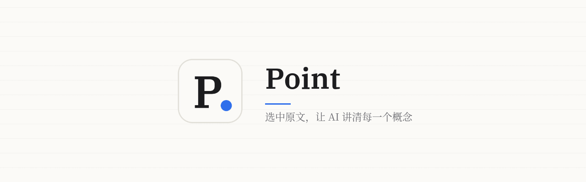
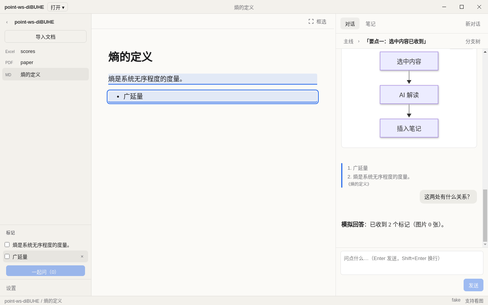

<p align="center"></p>

<p align="center">选中原文，让 AI 讲清每一个概念。<br>一个面向学习、概念理解和文献阅读的桌面应用，支持 Windows 和 macOS。</p>

<p align="center">
  <a href="https://github.com/Sqhh99/Point/releases">下载</a> ·
  <a href="docs/design/v0.2/README.md">设计稿</a> ·
  <a href="AGENTS.md">协作约定</a>
</p>

## 功能

- **导入并阅读文档**：PDF、Word（docx）、Markdown，直接在应用里阅读。
- **选中即问**：在原文里选中一段文字，可以让 AI 解读概念、记成笔记、画成图表（Mermaid），或者直接提问。
- **笔记**：AI 的回答一键插入笔记，笔记可导出为 Markdown 或打包成 zip。
- **多模型**：DeepSeek、OpenAI（GPT）、智谱 GLM，以及任何兼容 OpenAI 接口的服务。API key 用系统钥匙串加密保存在本机。
- **本地优先**：工作区就是一个本地文件夹，数据存在其中的 `.point/` 目录里。

### 正在开发（v0.1.1）

自定义标题栏和新的三栏布局、Excel 阅读、框选截图提问、标记后批量提问、可以无限派生的分支对话。界面见下方设计稿。

<p align="center"></p>

## 安装

在 [Releases](https://github.com/Sqhh99/Point/releases) 下载对应安装包：

| 平台 | 文件 |
|---|---|
| Windows x64 / ARM64 | `Point-<版本>-win-x64-setup.exe` / `win-arm64-setup.exe` |
| macOS Intel / Apple 芯片 | `Point-<版本>-mac-x64.dmg` / `mac-arm64.dmg` |

安装包目前没有签名：

- **macOS**：第一次打开时右键应用，选「打开」。
- **Windows**：SmartScreen 弹窗时点「更多信息」，再点「仍要运行」。默认装到当前用户目录，不需要管理员权限。

首次使用请在「设置」里填一个模型的 API key，点「测试连接」通过后即可开始。

## 本地开发

需要 Node 20+ 和 pnpm 10。

```bash
pnpm install
pnpm dev          # 启动应用
pnpm test         # 单元测试 + 主进程集成测试
pnpm lint && pnpm typecheck
pnpm --filter @point/desktop package   # 打本平台安装包
```

`POINT_FAKE_LLM=1` 换成假模型，`POINT_USER_DATA=<目录>` 把设置目录指到别处，测试时常用。

## 项目结构

```
packages/core     模型接入、文档解析、对话与笔记等纯 TypeScript 逻辑
apps/desktop      Electron 应用（main / preload / renderer）
docs/             设计稿、工作日志、PR 与代码审查记录
agents/           各协作 bot 的职责和约束
```

## 版本号

`va.b.c`：大升级或架构调整升 a，较大的功能调整和优化升 b，bug 修复和小优化升 c。
