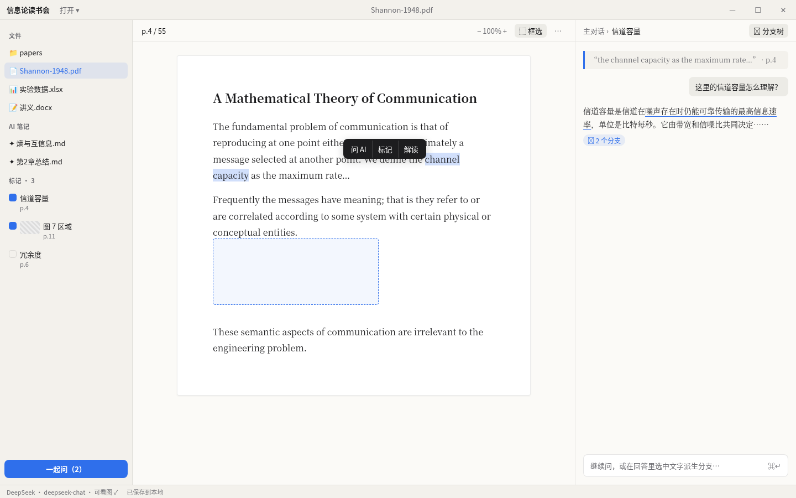

# Point v0.2 设计稿

 · 源文件 `mockup.html`（浏览器直接打开）

## 规范（唯一一套）
- 颜色只用 `renderer/style.css` 现有变量，不新增色值；强调色只有 `--accent`。
- 字体：界面 `--ui-font` 13px；阅读区与 AI 回答 `--read-font`（正文 16/1.85，对话 14/1.75）。
- 间距 4/8/12/16/24；圆角 8px（小控件 6px，纸页 4px）；分割线 `--line` 1px，不用阴影分栏。

## 布局
| 区域 | 尺寸 | 内容 |
|---|---|---|
| 标题栏 | 36px，`--panel` | 左：工作区名 +「打开 ▾」（工作区 / 单个文件）；中：当前文件名；右：Windows 46×36 窗口按钮。mac 左侧留 78px 给红绿灯，不画按钮。整条可拖，按钮 `no-drag` |
| 左栏 | 240px，可收起（`⌘\`） | 文件 / AI 笔记 / 标记 三组，组标题 11px 大写字距 |
| 阅读区 | 自适应 | 40px 工具条（页码、缩放、⬚ 框选、⋯ 含导出）；纸页最大 720px 居中 |
| 对话面板 | 400px，可拖 320–640 | 40px 面包屑 + 分支树按钮；消息流；输入框 |
| 状态栏 | 24px | 当前模型、是否支持看图、保存状态 |

## 交互
- **滑选文字**：松手 120ms 后浮动条出现在选区上方 8px（顶部放不下就翻到下方），按钮为「问 AI · 标记 · 解读」。在 AI 回答里选中时，按钮改为「追问分支 · 标记」。
- **框选**：`⌘⇧S` / `Ctrl+Shift+S` 或工具条按钮；十字准星，1.5px 虚线 `--accent` 框，`Esc` 取消；松手弹同一个浮动条。模型不支持看图时按钮置灰，tooltip「当前模型不支持图片」。
- **标记**：左栏每项 = 复选框 + 文字或 36×24 缩略图 + 页码；点击跳回原文（`Viewer.locate`）。勾选后底部按钮「一起问（n）」生效。
- **分支**：回答里派生过分支的片段加 `--accent` 细下划线（offset 4px）；回答末尾 chip「⑂ n 个分支」，点击进入。面包屑每级可点；「分支树」弹出 320px 浮层，缩进树显示，当前节点高亮。
- **AI 笔记**：md 在阅读区打开，排版与导入文件一致；导出仅在 ⋯ 菜单。
- 深色模式沿用现有 dark 变量，无额外设计。

## 重新生成与平级回答（2026-10-12 补）
- 回答底部的悬停操作「重新生成」会新增一条平级回答，不覆盖旧回答。
- 同一位置有多条回答时，回答左下角显示切换器 `‹ 2/3 ›`：12px `--muted`，箭头按钮 20×20、圆角 6px，悬停 `--hover`；到头的箭头置灰。快捷键 `⌥←/⌥→`（Windows `Alt+←/→`）。
- 默认显示最新一条；切换时只替换这条回答及其下方内容，面包屑同步，150ms 淡入，`prefers-reduced-motion` 时无动画。
- 「⑂ n 个分支」chip 只统计当前显示的那条回答的分支。

## 空状态（未打开工作区或文件）

- 阅读区居中，最大宽度 360px，垂直居中偏上（上移 8%）。
- 顶部是 48px 的 Point 标记（`build/icon.png`），透明度 0.9。
- 标题「打开一个工作区，或直接读一个文件」，16px，`--fg`；下方一行说明「支持 PDF、DOCX、XLSX、Markdown」，13px，`--muted`。
- 两个按钮横排，间距 12px，高 32px，圆角 6px：
  - 「打开工作区」：主按钮，`--accent` 底、白字，快捷键 `⌘O` / `Ctrl+O`。
  - 「打开文件」：次按钮，1px `--border` 描边，`--fg` 字，快捷键 `⌘⇧O` / `Ctrl+Shift+O`。
  - 快捷键以 12px `--muted` 显示在按钮下方。
- 有最近打开记录时，按钮下方 24px 处列出最多 5 条「最近」，每行 28px，左侧文件类型图标，右侧 `--muted` 路径，悬停 `--hover` 底。
- 支持把文件或文件夹直接拖进阅读区：拖入时整个阅读区显示 2px 虚线 `--accent` 边框和「松开即可打开」。
- 左栏在空状态下只显示同样的两个按钮的紧凑版（图标 + 文字，高 28px），不显示空树。
