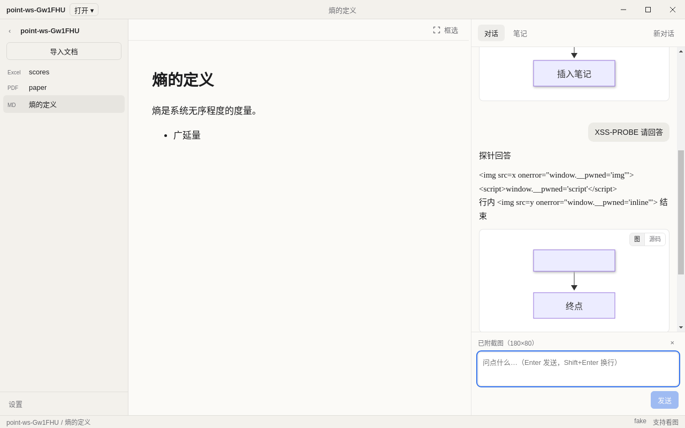

# ③ 框选截图 + 多模态模型 + 状态栏

版本：保持 0.1.1，不升。

> 本分支从 `feat/viewers`（#34，770073c）拉出。#34 合进 main 之前，本 PR 的 diff 里会带上 #34 的提交；#34 合入后我会把 main 合进来。

## 做了什么
- **框选截图**：
  - 阅读区顶部加了 40px 工具条，右侧是「⬚ 框选」按钮。快捷键 `⌘⇧S` / `Ctrl+Shift+S`。
  - 进入框选后阅读区变为十字准星，拖动时显示 1.5px `--accent` 虚线框，`Esc` 取消。
  - 松手后先把遮罩隐藏两帧，再由 main 用 `webContents.capturePage(rect)` 截图。
  - main 把 PNG 写到 `<工作区>/.point/captures/<sha256>.png`（按内容哈希，重复截图不重复存），只把 `{ sha, width, height }` 返回给渲染进程。
  - 截图附在对话输入框上（「已附截图（W×H）」，可移除），随下一个问题一起发送。用户消息的引用卡显示「[截图]」。
- **多模态模型**：
  - core：`ChatMessage.images`；`buildOpenAIBody` 把带图消息转成 OpenAI 的 content parts（`image_url` + data URL）；`modelCapabilities(id, model, override)`。
  - 预设：OpenAI 的 gpt-4o-mini / gpt-4o / gpt-4.1 标为支持看图；智谱新增 glm-4v-flash / glm-4v-plus；DeepSeek 不支持。
  - 设置页新增「该模型支持看图」勾选框，存为 provider 的 `vision`。与预设一致时不存，清空后回到预设判断。
  - 模型不支持看图时：框选按钮置灰，tooltip「当前模型不支持图片」；如果已经附了图，发送时在对话里直接显示中文错误和「去设置」，问题和截图都保留。main 里也会再拦一次，错误码是 `no_vision`，这时什么都不会存。
- **状态栏**（① 时延后的）：底部 24px，`--panel` 底、`--muted` 12px 字。左侧显示「工作区 / 当前文档」，右侧显示当前模型名和「支持看图 / 不支持看图」。从设置页返回时会刷新。

## 安全
- 渲染进程只传 sha。校验在 `src/main/capture.ts` 的导出函数 `isCaptureSha` / `assertCaptureSha` 里，只认 `/^[0-9a-f]{64}$/`：大写、`../`、长度不对、非字符串一律拒绝。路径只由 `capturePath(root, sha)` 在 main 里拼。
- 框选区域在 main 里用 `toCaptureRect` 校验：必须是有限数字、非负，边长在 4 到 10000 之间。
- 图片的 base64 只在 main 里读，API Key 仍然不离开 main。
- `chat:start` 现在会把渲染进程传来的每条消息重建成只有 `{ role, content }`，渲染进程没法自己塞 `images`。
- `window:*` 白名单没动。

## 测试
- core：143 项通过（新增：请求体构建、带图请求、`modelCapabilities`、只有截图时可以解读）。
- main：316 项通过，4 项跳过（跳过的是只在其他平台跑的用例）。新增 `capture.test.ts`，覆盖 sha 校验（13 种非法输入）、路径拼接、区域校验、写入读回和去重、capture IPC（mock `capturePage`）、带图任务、不支持看图时报错且不落库、非法和缺失的 sha、设置里的 vision 默认值、覆盖和清空，以及 `chat:start` 丢掉 images。新增 `capture-layout.test.ts`，覆盖快捷键和拖框计算。
- e2e：12 项通过，1 项跳过（原有的、Linux 上系统加密不可用的用例）。新增一条：状态栏高 24px 且内容正确；按钮进入框选、Esc 退出；快捷键进入框选后拖框，`.point/captures/` 里有一个 `<sha>.png`；附图提问拿到回答；`tasks.run` 传 `../index.db` 被拒。
- lint、typecheck 的退出码都是 0。

## 截图

## 下一个 PR 再做
- 项目里目前只有 OpenAI 兼容格式的 provider，没有 Anthropic，所以这次只做了 OpenAI 格式的图片请求。要接 Anthropic 时再加对应的 `image` source 块。
- 设计稿里「松手后弹出同一个浮动条（问 AI · 标记 · 解读）」这次简化成直接附到输入框；浮动条和「标记」一起放到 ④。
- 截图缩略图：CSP 现在是 `img-src 'self'`，没有放开 data: / 自定义协议，所以对话里只显示「[截图]」文字。
- 历史消息里的截图不会在追问时重新发送，只发当前这条问题附的图。
- 状态栏里的「保存状态」等笔记自动保存做完后再接。
