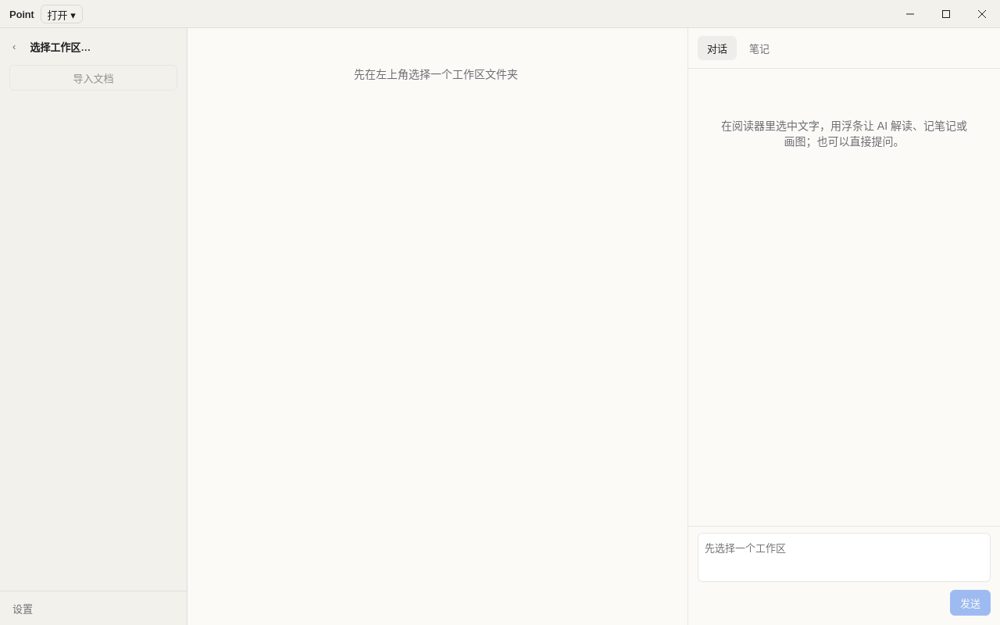

# PR：feat(ui): 自定义标题栏和三栏布局（①）

- **日期：** 2026-10-12 / **分支：** `feat/titlebar-layout` → `main` / **基线 commit：** `c1eccea` / **相关记录：** [工作日志](../work-logs/2026-10-12-titlebar-layout.md)

## 关联
用户反馈里“自定义标题栏、精致的布局、统一风格”这几条。本 PR 是这一轮拆分里的 ①，按 `docs/design/v0.2/` 实现。

## 改了什么
- 窗口：macOS 用 `hiddenInset`，保留系统红绿灯，左侧留出 78px；Windows 用 `frame:false`，自己画 46×36 的最小化、最大化/还原、关闭按钮。最大化状态由 main 推送给界面。
- 标题栏高 36px：左边是工作区名和「打开 ▾」（工作区 / 导入文件），中间是当前文件名。整条可以拖动，按钮区域设为 `no-drag`；Windows 上双击标题栏会最大化或还原。
- `window:action` IPC 只接受白名单里的 `minimize`、`toggleMaximize`、`close`，其他任何值在 main 里直接报错，不会执行。
- 三栏布局：对话面板默认 400px，可以在 320 到 640px 之间拖动，宽度存在 localStorage；`⌘\` 或 `Ctrl+\` 收起和展开左栏。
- 颜色只用 `style.css` 里已有的变量，关闭按钮悬停用 `--danger`。

## 改动类型
- [ ] Bug 修复
- [x] 新功能
- [ ] 性能或重构（不改变行为）
- [ ] 仅文档、CI 或构建

## 版本号
不升。这一轮的版本号已经在 #16 里升到 `0.1.1`。

## 如何测试
- [x] `pnpm lint` 和 `pnpm typecheck` 通过
- [x] `pnpm test` 通过（core 91、main 77，新增 `window-ipc.test.ts`：白名单动作、最大化切换、拒绝 `setBounds`、`__proto__`、空值和对象等非法值）
- [x] e2e 通过（Linux xvfb，10 过 1 跳过），新增标题栏用例：高 36px、Windows 按钮存在、非法动作被拒绝
- [ ] 两个平台的 CI：等这个 PR 跑完

## 检查项
- [x] UI 改动附截图

## 已知限制
设计稿里的 24px 状态栏（当前模型、是否支持看图、保存状态）放到 ③ 一起做，因为“是否支持看图”依赖 ③ 的 `capabilities.vision`。左栏的文件 / AI 笔记 / 标记三组分组放到 ② 和 ④。
