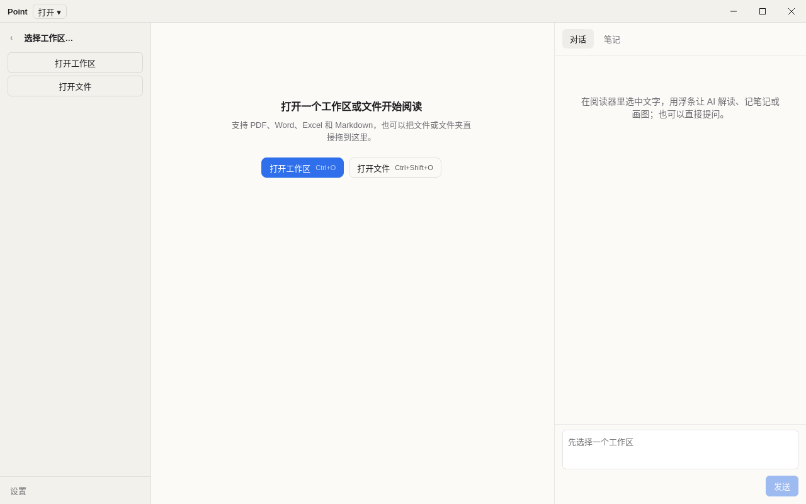
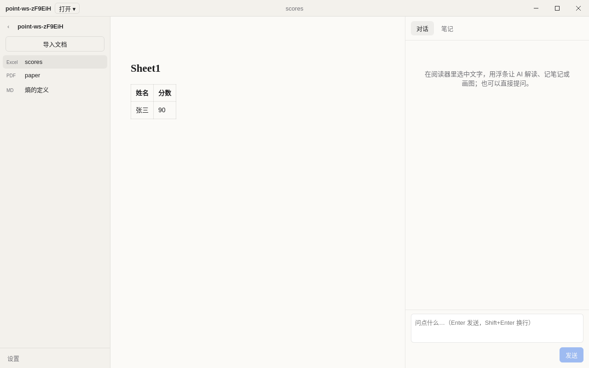

# ② 打开工作区 / 单个文件 + Excel 阅读

版本：保持 0.1.1（本轮已在 #16 升过，不再升）。

## 做了什么
- **Excel / CSV 阅读**：`packages/core/src/docs/xlsx.ts`。每个非空 sheet 生成一个二级标题加一张表，每个 sheet 最多 2000 行，超出部分会加一行说明。读取时不算公式，只用缓存值。CSV 先按 UTF-8 解码，会去掉 BOM，所以中文不会乱码。SheetJS 用 CDN 上的 tarball 固定版本，锁文件里带 sha512 校验。
- **单文件模式**：没有工作区时打开文件，会导入到 userData 下的 `scratch` 文件夹里，并把它当作临时工作区。这个文件夹本身不进最近记录，也不能被当成外部路径打开。
- **空状态**（按 #29 设计稿）：两个居中按钮「打开工作区」（主按钮，`⌘O`/`Ctrl+O`）和「打开文件」（`⌘⇧O`/`Ctrl+Shift+O`），下面是最多 5 条最近记录。左栏只放两个小按钮。
- **拖放**：可以把文件或文件夹拖进窗口。

## 安全（PR评审员的要求：路径只能在 main 里校验）
- 渲染进程**从不传路径**：
  - 对话框是 main 自己弹的。
  - 打开最近记录只传序号（`open:recentAt`），main 去自己的 `recent.json` 里取路径，传错序号就报「无效的最近记录」。
  - 拖进来的东西会触发 Chromium 导航到 file:// 地址，main 在 `will-navigate` 里拦下来，取出路径自己打开，再用 `open:opened` 通知渲染进程。其他导航也一律拦掉。
- 所有外部路径都经过同一个函数 `resolveOpenTarget`（`src/main/open-ipc.ts`）：必须是绝对路径，不能含 NUL，必须存在；先 `realpath` 解开符号链接，然后拒绝 scratch 目录，文件还必须是支持的类型。

## 测试
- core：101 项通过，新增 xlsx 6 项，包括 UTF-8 CSV 带 BOM 和不带 BOM 两种情况。
- main：206 项通过，覆盖单文件模式、导入到已有工作区、取消、非法路径、符号链接指向 scratch、按序号打开最近记录（含非法序号）、最近记录去重、上限和文件损坏。
- e2e：11 项通过，新增空状态用例和 CSV 导入后表格渲染的检查。
- e2e 发现了一个真 bug：SheetJS 把 UTF-8 CSV 当旧代码页读，中文会乱码。已修复，并加了单测。

## 截图

## 下一个 PR 再做
- UI设计员 补充的三项：
  - 底部 28px 的 sheet 标签，加冻结表头。
  - 文件损坏、加密或 0 字节时，在阅读区显示提示和「重新选择文件」按钮。
  - 打开大文件时显示 2px 的顶部进度条。
- 用 pdf.js 画布渲染 PDF。现在 PDF 和 DOCX 仍然是文本块渲染。
- 同一个文件打开两次会重复导入。
